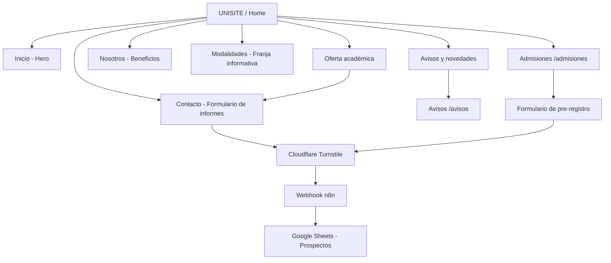
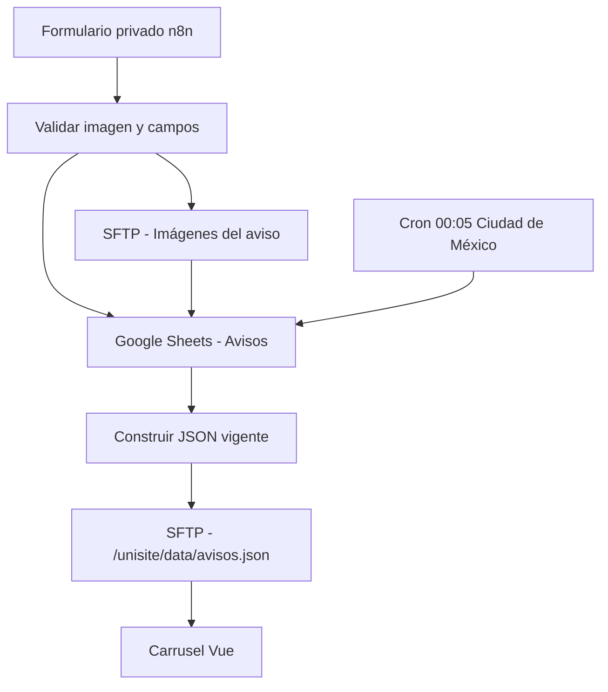

# Mapa de navegación y flujo funcional

## Sitio público

El menú público contiene **6 opciones**: Inicio, Oferta académica, Nosotros, Modalidades, Admisiones y Contacto. Avisos tiene acceso dentro de su propia sección y una vista de listado, sin añadir innecesariamente otra opción al menú principal.

## Avisos sin build

La Home y la vista `/avisos` leen `data/avisos.json`, sin dependencias PHP ni compilación en cada anuncio.
